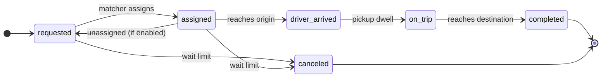

# open-ride-hailing-simulator: Specification

A deterministic discrete-event simulator that replays rider requests against a fleet, with pluggable matching, routing, readers and writers.

## Contents

- [Goal and scope](#goal-and-scope)
- [Conventions](#conventions)
- [Inputs and settings](#inputs-and-settings)
- [File formats and I/O plugins](#file-formats-and-io-plugins)
- [Lifecycles](#lifecycles)
- [Routing hook](#routing-hook)
- [Matching hook](#matching-hook)
- [Simulation loop](#simulation-loop)
- [Outputs](#outputs)
- [Worked example](#worked-example)

## Goal and scope

Replay a time-ordered sequence of rideshare requests against a fleet of supply (cars). Use the result to evaluate matching strategies on rider wait, trip efficiency and fleet utilization. Matching and routing are plug-ins; the simulator owns time, state, location interpolation and logging.

- In scope: the event clock, request and supply lifecycles, rider cancellations, plan execution, interpolating positions, output logs and summary metrics.
- Out of scope (v1): pricing, drivers declining, traffic that changes during a route, and rider walking. Idle repositioning is possible only through plans the matcher sends.

## Conventions

| Item | Convention |
|---|---|
| Timestamps | Unix epoch integers in seconds, such as `1793721600`, in inputs and outputs alike. Field names end in `_at` |
| Location | `{lat, lng}` as signed decimal degrees (WGS84), such as `{"lat": 37.802851, "lng": -122.405822}`. South and west are negative, with no N, S, E or W letters |
| Distance | Integer meters, with field names ending in `_meters` |
| Duration | Integer seconds, with field names ending in `_seconds` |
| Naming | Explicit names only, with no abbreviations such as `_s`, `_m` or `avg` |
| Polyline | Encoded polyline or a list of `{lat, lng}` points, chosen once per run |
| IDs | Strings: `request_id`, `supply_id`, `plan_id` |
| Tie-break | Same-timestamp events run in the order offline, dropoff, pickup, cancellation, supply online, request, batch tick, then by ID |
| Determinism | No random numbers anywhere in the simulator. Iteration order is always sorted by ID. |

## Inputs and settings

### Settings file

| Setting | Type | Default | Meaning |
|---|---|---|---|
| `max_request_to_assignment_seconds` | seconds | none (off) | The rider cancels if still not assigned this long after requesting |
| `max_request_to_pickup_seconds` | seconds | none (off) | The rider cancels if not picked up this long after requesting, whether assigned or not |
| `pooling_enabled` | bool | false | Allows more than one request on a car at once, within seats |
| `reassignment_enabled` | bool | true | Allows moving an assigned request to another car before pickup |
| `batch_matching_interval_seconds` | seconds | none (off) | Also calls the matcher on this fixed interval from the start |
| `pickup_dwell_seconds` | seconds | 0 | Time stopped at a pickup |
| `dropoff_dwell_seconds` | seconds | 0 | Time stopped at a dropoff |
| `default_num_requested_seats` | int | 4 | Used when a request leaves it out |
| `default_num_available_seats` | int | 4 | Used when a supply leaves it out |
| `average_speed_meters_per_second` | float | router-specific | Used only by the built-in straight-line router |

The settings file is TOML. It also names the matching hook, the routing hook, and the reader and writer plugins along with their options, such as file paths or a database connection.

### Demand (ride requests)

| Field | Type | Notes |
|---|---|---|
| `request_id` | string | Unique |
| `requested_at` | time | When the rider requests |
| `origin_lat` | decimal | Pickup latitude |
| `origin_lng` | decimal | Pickup longitude |
| `destination_lat` | decimal | Dropoff latitude |
| `destination_lng` | decimal | Dropoff longitude |
| `num_requested_seats` | int | Optional; defaults to the setting |
| `max_request_to_assignment_seconds` | seconds | Optional override of the setting |
| `max_request_to_pickup_seconds` | seconds | Optional override of the setting |

### Supply (cars)

| Field | Type | Notes |
|---|---|---|
| `supply_id` | string | Unique |
| `online_at` | time | May be before the first request |
| `online_lat` | decimal | Latitude where it comes online |
| `online_lng` | decimal | Longitude where it comes online |
| `offline_at` | time | Optional; goes offline once its plan is finished |
| `num_available_seats` | int | Optional; defaults to the setting |

## File formats and I/O plugins

| Data | Default format |
|---|---|
| Settings | TOML file |
| Ride requests, supply | CSV with a header row |
| Trips, supply event log, supply summary, run summary | CSV with a header row |

### CSV conventions

- Timestamps, distances and durations are integers; an empty cell means null or unset.
- Polylines are a single encoded-polyline string per cell.
- A list such as `plan` is a JSON string in one cell.
- Optional input columns can be left out entirely; settings defaults apply.

### Reader and writer plugins

The simulator core never touches files directly. It talks to small interfaces, and CSV is just the default implementation, so a database, Parquet or an in-memory source can be swapped in through settings without changing the core.

| Interface | Contract |
|---|---|
| `SettingsReader` | Returns the validated settings object. The default reads TOML |
| `RequestReader` | Yields ride requests in `requested_at` order (or the simulator sorts them) |
| `SupplyReader` | Yields supply records |
| `OutputWriter` | One per output stream: `open()`, `write(record)` (or a batch), `close()`. The simulator can stream rows as they happen |

Each plugin works with typed records whose field names match this spec, so every reader and writer shares one schema. Validation (required fields, ranges, unique IDs) runs in the core after reading, so it's the same for every source.

## Lifecycles

Request lifecycle (the dashed edge applies only when reassignment is enabled):

A cancellation records which limit fired in `cancel_reason` (`max_request_to_assignment` or `max_request_to_pickup`). The assignment limit is checked against `requested_at` plus `max_request_to_assignment_seconds`: at any time from that deadline on, if the request is waiting with no car assigned (never assigned, or unassigned again), the rider cancels. Requests already picked up are never affected. A rider whose car is already at the origin can still cancel during the pickup dwell. If a request is canceled, the simulator removes its stops from the car's plan and reroutes the car.

Supply states are `offline`, `idle` (online with no plan), `en_route` (next stop is a pickup and no rider is aboard), `on_trip` (at least one rider aboard), and `going_offline` (past offline_at but still finishing its plan).

## Routing hook

The simulator calls this whenever a supply's plan changes. The matcher can also call it to estimate candidate plans.

| | Shape |
|---|---|
| Input | `route(start: location, waypoints: location[], depart_at: time)` |
| Output | `legs[]`, one per consecutive pair of stops. Each leg is `{segments[], distance_meters, duration_seconds}` |
| Segment | `{polyline, distance_meters, duration_seconds}`; the vehicle moves at constant speed within a segment |
| Units | `distance_meters` and `duration_seconds` are integers, so every event in the simulation falls on a whole second |
| Errors | Unroutable returns an error. The simulator rejects that plan change and logs it |
| Determinism | Must return the same output for the same input for runs to be reproducible |

Reference implementation: literal straight lines. Distance is the great-circle (haversine) distance between points, duration is that distance divided by `average_speed_meters_per_second`, and each leg is one straight segment. Both are rounded to whole meters and seconds.

## Matching hook

| | Shape |
|---|---|
| Input | `now`, `trigger` (`request`, `supply_online`, `supply_offline` or `batch_tick`), the settings, every online supply, every open request (requested or assigned, not yet picked up, not canceled), and the routing handle |
| Supply view | `{supply_id, location, state, num_available_seats, seats_in_use, plan}`. The plan lists each waypoint as `{request_id, type: pickup\|dropoff, location, eta_at}` for every remaining stop |
| Request view | `{request_id, requested_at, origin, destination, num_requested_seats, status, supply_id, assigned_at, cancel_at}`. `cancel_at` is the earliest time a wait limit will cancel it |
| Output | A list of plan changes: `{supply_id, plan}`, where `plan` is the ordered list of stops, each `{request_id, type}`. An empty list means no supply state changes (a no-op) |

The matcher sends only the ordered stops. The simulator starts the plan from the car's current location and adds the route and the ETA of each stop; that full plan is what the matcher sees on its next call.

### Validation (simulator enforces)

- Each request's pickup comes before its dropoff, and both are in the same plan.
- Riders already aboard keep their dropoff and stay with their car.
- With pooling off, at most one rider is aboard at a time: each pickup must come after the previous request's dropoff. A plan can still hold several requests back to back (forward dispatch).
- With pooling on, seats in use never exceed `num_available_seats` at any point along the plan.
- With reassignment off, an assigned request can't be moved to another car or dropped from its plan.
- A request is in at most one plan.
- An invalid change is rejected as a whole and logged as `plan_rejected`; the supply keeps its previous plan.

## Simulation loop

1. **Initialize.** Load the settings and inputs, filling in defaults. The clock starts at the first `requested_at`. Supply with `online_at` before that is online and idle at (`online_lat`, `online_lng`).
2. **Queue events.** A priority queue holds external events (request, supply online, supply offline), internal ones (arrive at stop, dwell done, cancellation deadline) and batch ticks every `batch_matching_interval_seconds`. Order is by time, then the tie-break rule.
3. **Advance.** Pop the next event, set the clock to it, and interpolate every moving supply's position along its current route.
4. **Apply the event.** Update request and supply state, including cancellations and removing canceled stops, and write to the event log.
5. **Match.** Call the matcher only on external events (request, supply online, supply offline) and batch ticks. Internal events (arrivals, dwells done, pickups, dropoffs, cancellations) update state and logs but never call the matcher. Validate and apply its plan changes.
6. **Route.** For each changed plan, call the router from the current location, replace the route, recompute waypoint ETAs, and reschedule arrival events. Stale ones are cancelled.
7. **Terminate.** Stop once every supply plan is finished and no requests, arrivals or deadlines remain. Batch ticks alone don't keep the run going. Then write the outputs.

> **Interpolation:** To place a car at time t, find the route segment that contains the time elapsed since the route started, then interpolate linearly along that segment's polyline by distance. During a dwell, the car stays at the stop.

## Outputs

### 1. Trips (one row per request)

| Field | Meaning |
|---|---|
| `request_id` | The request |
| `status` | Final status: `completed` or `canceled` |
| `requested_at` | When the rider requested |
| `num_requested_seats` | Seats used |
| `first_assigned_at` | First assignment time |
| `assigned_at` | Final assignment time |
| `supply_id` | Final car |
| `reassign_count` | How many times the request was reassigned |
| `ridepool_type` | The pickups (`p`) and dropoffs (`d`) the car made between this trip's final `assigned_at` and its dropoff, in order. `0` is this trip; other requests are numbered `1` to `n` in the order they first appear. A normal trip is `p0d0`, a forward dispatch is `d1p0d0`, and a pooled trip might be `p0p1d0`. Empty for a canceled trip |
| `eta_at_assignment_seconds` | Pickup ETA quoted at the final assignment |
| `driver_arrived_at` | Car reaches the origin |
| `pickup_at` | Rider boards, after the dwell |
| `dropoff_at` | Car reaches the destination |
| `wait_seconds` | `pickup_at` minus `requested_at` |
| `trip_distance_meters` | Distance from pickup to dropoff as driven, including pooling detours |
| `trip_duration_seconds` | Time from pickup to dropoff, including pooling detours |
| `direct_distance_meters` | Distance of the direct route from origin to destination |
| `detour_ratio` | `trip_distance_meters` divided by `direct_distance_meters` |
| `pickup_distance_meters` | Distance the car drove to the pickup after the final assignment |
| `canceled_at` | When the rider canceled, if they did |
| `cancel_reason` | Which limit fired: `max_request_to_assignment` or `max_request_to_pickup` |

### 2. Supply event log (one row per action)

| Field | Meaning |
|---|---|
| `supply_id` | The car |
| `at` | When the action happened |
| `action` | One of `online`, `plan_updated`, `plan_rejected`, `arrived_pickup`, `pickup`, `arrived_dropoff`, `dropoff`, `stop_removed` (the rider canceled), `idle`, `offline` |
| `lat` | Car latitude at the action |
| `lng` | Car longitude at the action |
| `state_after` | Car state after the action |
| `request_id` | Related request, if any |
| `plan_id` | Current plan |
| `seats_in_use` | Seats in use after the action |
| `odometer_meters` | Total distance driven so far |
| `driven_polyline` | The path actually driven since this car's previous row |
| `planned_polyline` | On `plan_updated` rows: the full new route from the router |
| `plan` | On `plan_updated` rows: the new plan's stops with their ETAs |

### 3. Supply summary (one row per supply)

| Field | Meaning |
|---|---|
| `supply_id` | The car |
| `online_at` | When it came online |
| `offline_at` | When it went offline, or empty if it never did |
| `idle_seconds` | Time spent idle |
| `en_route_seconds` | Time spent driving to pickups with no rider aboard |
| `on_trip_seconds` | Time with at least one rider aboard |
| `idle_meters` | Distance driven while idle (repositioning) |
| `en_route_meters` | Distance driven to pickups with no rider aboard |
| `on_trip_meters` | Distance driven with at least one rider aboard |
| `requests_served` | Requests completed |
| `utilization` | `on_trip_seconds` divided by time online |
| `deadhead_ratio` | Distance driven with no rider aboard divided by total distance |
| `full_polyline` | The car's whole driven path |

### 4. Run summary

Totals: requests completed and canceled (split by reason), median and p90 wait, mean detour ratio, fleet utilization, matcher calls by trigger, and time spent in the matcher and router.

## Worked example

_Pooling on_

| Time | Event | Result |
|---|---|---|
| T0 | S1 online at L1 | S1 idle; the clock hasn't started yet |
| T1 | R1 requested, O1 to D1 | The clock starts. The matcher returns S1 with plan [pickup R1, dropoff R1]. The router returns legs L1 to O1 and O1 to D1, and ETAs are set for both stops |
| T2 | R2 requested, O2 to D2 | S1 is interpolated to L2. The matcher sees S1's plan with ETAs and returns [pickup R1, dropoff R1, pickup R2, dropoff R2]. The router is called again from L2 |
| Every interval | Batch tick | The matcher is called; an empty result changes nothing |
| T3 to T6 | Arrivals and dwells | Arrival, pickup and dropoff are logged for R1, then for R2, each row with its driven polyline |
| End | S1's plan is finished and the queue is empty | The outputs are written |
